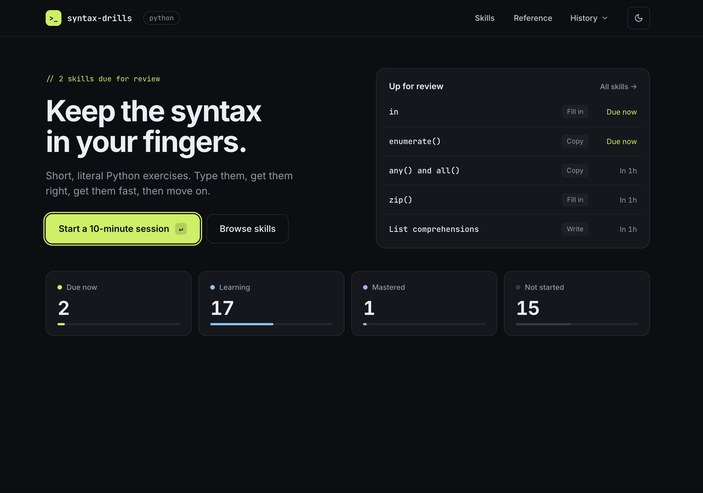
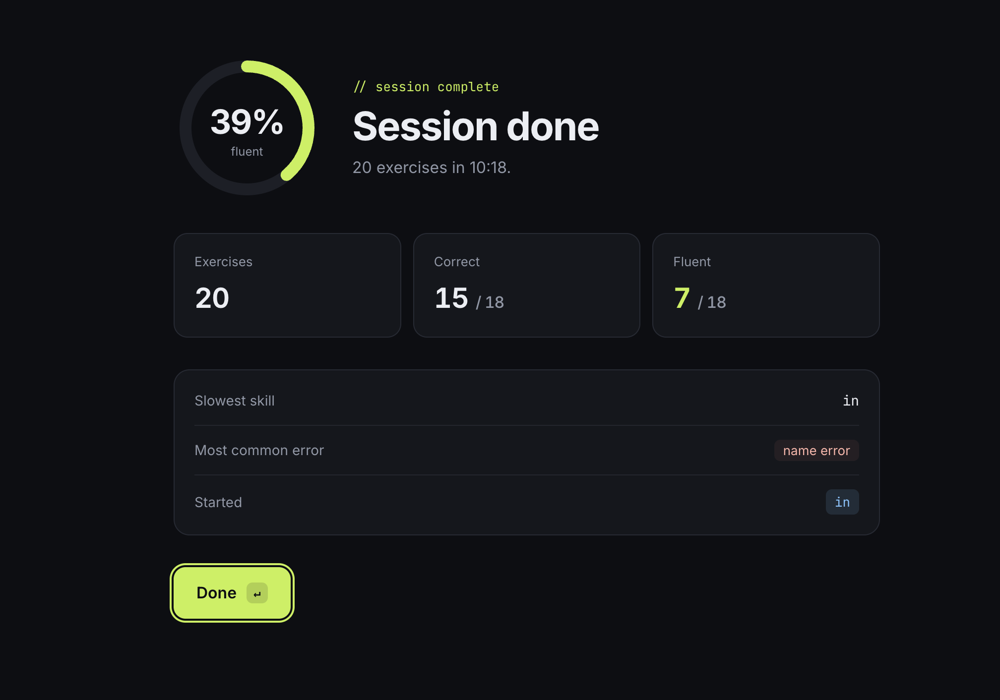

# Syntax Drills

Adaptive, keyboard-first drills for getting a language's syntax into your fingers.
Short, literal exercises ("map these months to their totals"), timed, with no autocomplete.
Python first.

<table>
  <tr>
    <td width="50%" valign="top">
      
    </td>
    <td width="50%" valign="top">
      
    </td>
  </tr>
  <tr>
    <td align="center"><sub>Home: what's due for review, and where every skill stands</sub></td>
    <td align="center"><sub>After a session: accuracy, fluency and what to work on</sub></td>
  </tr>
</table>

## Run it

```bash
npm install
npm run dev        # http://localhost:5199
```

Everything runs in the browser: Python via Pyodide, history in IndexedDB. Use
**Export history** on the home screen to back up your progress.

## Checks

```bash
npm run check      # typecheck + tests + module boundaries + content validation
```

## Using it

- **First time:** take the placement test (up to 15 exercises) or start from the beginning.
- **Daily:** one 10-minute session. Two warm-ups, then reviews and at most one new skill.
- **Levels:** each skill moves through _Copy_ (type shown code), _Fill in_ (complete the
  blanks) and _Write_ (from scratch). Misses move it down; two clean passes move it up.
- **Keys:** <kbd>⌘</kbd><kbd>↵</kbd> checks your code, <kbd>↵</kbd> moves on after a pass.
- **Show answer** counts as a miss, then you retype the answer to continue.
- **Reference:** a short cheat sheet for every skill, from the home screen or by clicking a
  skill on the Skills screen. <kbd>←</kbd> <kbd>→</kbd> step through them.

## Adding exercises

Add a template to a file in `content/python/core/templates/` (the header of
`collections.yaml` explains the format), then run `npm run validate-content`. A new skill
also needs an overview card in `content/python/core/overviews/<skill-id>.md`.

See [docs/architecture.md](docs/architecture.md) for how it's put together.
